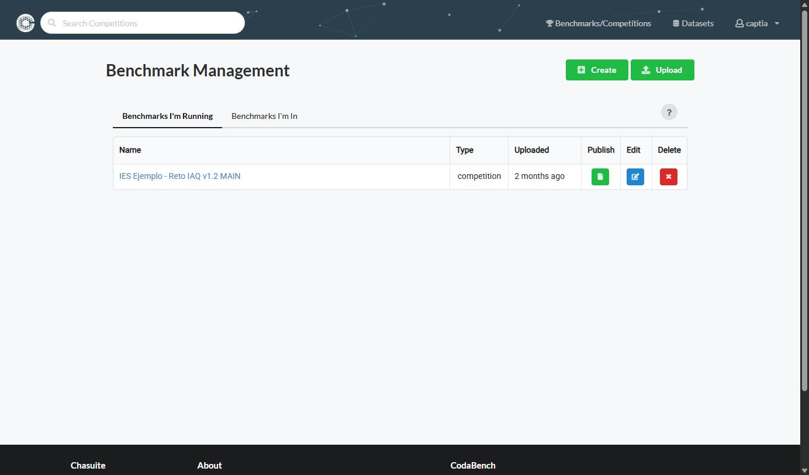
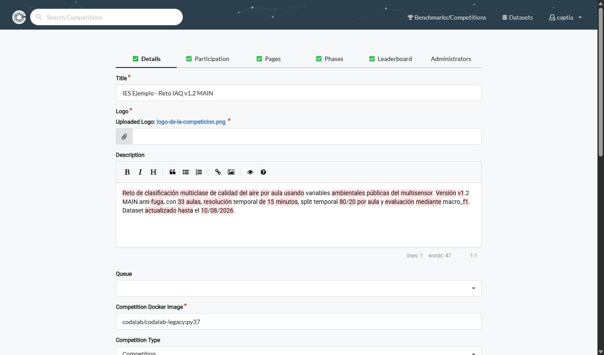

# Details

**Objetivo:** crear la competición en Codabench y rellenar la pestaña Details, que es la que le da título, logo, descripción y cola de procesamiento.

## Crear la competición

1. En el menú superior: **Benchmarks → Management**.
2. Click en **Create** (botón arriba a la derecha de Benchmark Management).

*La lista solo muestra las competiciones propias. El botón **Edit** de cada fila abre el mismo editor que se describe a continuación; **Publish** la hace visible y **Delete** la borra.*
3. Se abre el editor de la competición con seis pestañas —**Details**, **Participation**, **Pages**, **Phases**, **Leaderboard** y **Administrators**—. Rellenar **Details**:

| Campo | Para qué |
|---|---|
| **Title** | Nombre de la competición. |
| **Logo** | Imagen identificativa. |
| **Description** | Resumen que aparece en el listado de competiciones. |
| **Queue** | Cola de procesamiento de submissions. Se elige entre las que se hayan creado en la gestión de colas; sin ninguna propia, se usa la pública. |
| **Competition Docker Image** | Imagen en la que se ejecutan ingestion y scoring. Ver la nota de abajo. |
| **Competition Type**, **Competition Reward** | Clasificación y premio, informativos, para el listado público. |
| **Organizer Contact Email** | A quién escribe un participante con un problema. |
| **Competition Report**, **Fact Sheet** | Enlace a un informe y fichas de datos adicionales de la competición. |

*Las seis pestañas, arriba. El tic verde marca las que ya están completas, y **Administrators** aparece sin él porque es opcional. Abajo, `Competition Docker Image` con el valor por defecto a la vista.*

En este punto la competición ya existe (en borrador) y se puede seguir editando en cualquier momento.

:::note[El Docker image que aparece sin haberlo escrito]
La cabecera pública de la competición muestra un **Docker image** —normalmente `codalab/codalab-legacy:py37`— aunque nadie lo haya escrito. No es que lo herede de la cola ni de la Task: es el campo **Competition Docker Image** de esta misma pestaña, que tiene **ese valor por defecto** en el modelo de la competición.

La consecuencia práctica importa: si el scoring program necesita una librería que esa imagen no trae, el fallo será un `ModuleNotFoundError` en el log de la submission, y se arregla **aquí**, poniendo una imagen que sí la incluya. No hace falta tocar YAML ni cambiar de cola.
:::

**Siguiente paso:** [Participation](./participation.md) — quién puede registrarse y bajo qué términos.
