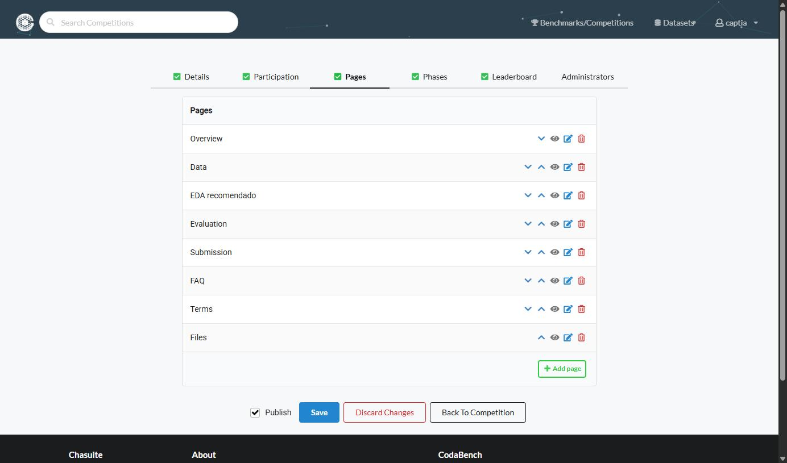

# Pages

**Objetivo:** redactar las pestañas informativas que verá el participante dentro de la competición pública.

Pestaña **Pages** — contenido informativo que verán los participantes como pestañas dentro de la competición pública (Overview, Data, Evaluation, etc.).

## Añadir páginas

1. Click **Add page**.
2. Rellenar **Title** y **Content** (markdown).
3. Repetir por cada página necesaria.

## Enlaces entre páginas

Se puede enlazar entre páginas usando anchors del tipo `_tab_page0`, `_tab_page1`, `_tab_page_term` (para la pestaña de [Terms](./participation.md)).

*Las flechas de cada fila cambian el orden en que aparecen las pestañas al participante, y ese orden es el del recorrido que se espera de él: qué es esto, qué datos hay, cómo se evalúa y cómo se entrega.*

## Patrón habitual de páginas

Patrón habitual de páginas en una competición de tipo "predicciones directas": `Overview` (objetivo, flujo de trabajo resumido), `Data` (estructura del dataset, columnas públicas/excluidas, split train/test), `Evaluation` (métrica principal, formato exacto de submission, reglas de validación), `Submission` (paso a paso para generar y subir la entrega), `FAQ`, y opcionalmente `Files` (enlaces directos de descarga a los recursos públicos — Public Data, Starting Kit — dejando claro qué NO debe descargar el participante, p. ej. `reference_data`/`scoring_program`, aunque esos recursos ya son privados por configuración en Resources).

**Siguiente paso:** [Administrators](./administrators.md) — la última pestaña de la competición, opcional y rellenable en cualquier momento.
