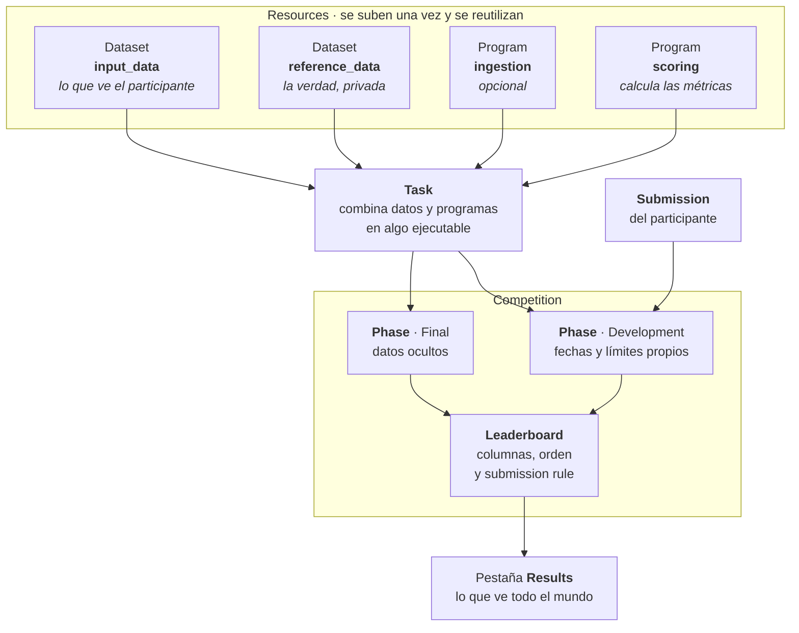

# Conceptos clave

**Objetivo:** reconocer los bloques con los que se construye una competición en Codabench y saber en qué parte de la guía se configura cada uno.

Antes de tocar la interfaz, conviene tener claros los bloques con los que se construye una competición.

La flecha que más se malinterpreta es la que **no** está: `reference_data` nunca llega al participante. Entra en la Task, la usa el scoring program para comparar, y ahí se queda.

## Los bloques de una competición

| Concepto | Qué es |
|---|---|
| [**Competition**](../competicion/index.md) | La competición en sí: título, descripción, páginas, fases y leaderboards. |
| [**Dataset**](../recursos/datasets-programs.md) | Datos subidos como recurso. Cada uno declara su tipo: `input_data` (lo que consume la Task), `reference_data` (ground truth), `public_data` y `starting_kit` (lo que se reparte al participante). |
| [**Program**](../recursos/datasets-programs.md) | Código ejecutable subido como recurso. Dos tipos: **Ingestion program** (transforma la submission del participante en predicciones) y **Scoring program** (compara predicciones contra `reference_data` y calcula métricas). |
| [**Task**](../recursos/tasks.md) | Combina Datasets + Programs (input_data, reference_data, ingestion program, scoring program). Se crea una vez y se reutiliza en una o varias Phases. |
| [**Phase**](../evaluacion/phases.md) | Etapa temporal de la competición (ej. `Development`, `Final`). Referencia una o varias Tasks y tiene sus propias fechas y límites de submission. |
| [**Leaderboard**](../evaluacion/leaderboards.md) | Tabla de resultados: columnas (métricas), orden de ranking y regla de qué submission de cada participante se muestra. |
| [**Submission**](../submissions/formato.md) | Lo que sube un participante: predicciones o código, según cómo esté configurada la Task. |

## Los recursos se crean una vez, no una por fase

Los recursos —los Datasets y los Programs— y las Tasks se crean **una sola vez** y luego se reutilizan al vincularlos desde las Phases — no se suben de nuevo por cada fase.

**Siguiente paso:** [La competición de ejemplo](./ejemplo.md) — el caso concreto al que se refiere el resto de la guía.
