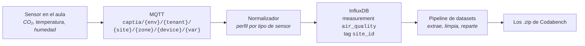

# La competición de ejemplo

**Objetivo:** tener delante un caso concreto —datos, ficheros, métrica y formato de entrega— al que referirse cada vez que la guía hable de un Dataset, una Task o una columna del leaderboard.

Todo lo que se explica a partir de aquí se puede seguir en abstracto, pero se entiende antes con un caso delante. El que usa esta guía es el que motivó escribirla: **clasificar la calidad del aire interior de las aulas de un instituto** a partir de la telemetría que ya recoge la plataforma.

## De dónde salen los datos

No se recogen para la competición: ya existen. Son los mismos que alimentan los paneles del centro, y llegan por el camino de siempre.



El normalizador deja cada lectura con el mismo esquema, venga del sensor que venga:

| Campo | Unidad | De dónde sale |
|---|---|---|
| `co2_ppm` | ppm | Sensor de CO₂ del aula |
| `temperature_c` | °C | El mismo sensor, o la sonda de la unidad de clima |
| `humidity_pct` | % | Sensor de CO₂ del aula |
| `site_id` | — | Etiqueta del centro, la que separa un instituto de otro |
| `device_id` | — | El dispositivo concreto: `aula_101_co2`, `aula_102_co2`, … |

El paso de ahí a un dataset de competición —agrupar por franja, descartar lecturas inválidas, repartir en `train` y `test` sin que se cuelen las mismas horas en los dos lados— lo hace el motor de generación, que vive en el repositorio privado `captia-technology/codabench-dataset-pipeline`. Esta guía empieza cuando ese motor ya ha dejado los `.zip` en disco.

## Qué se predice

Cada fila es **un aula en una franja lectiva**, y la etiqueta es la clase de calidad del aire de esa franja:

| Clase | Criterio orientativo | Qué significa para el centro |
|---|---|---|
| `buena` | CO₂ por debajo de 800 ppm | Ventilación suficiente |
| `aceptable` | Entre 800 y 1200 ppm | Conviene ventilar en el cambio de clase |
| `deficiente` | Por encima de 1200 ppm | Hay que actuar: la concentración afecta al rendimiento |

El participante recibe las variables de la franja **anterior** y tiene que anticipar la clase de la siguiente. Esa es la utilidad real: si se sabe antes, se ventila antes.

## Los ficheros

| Recurso | Qué lleva | Quién lo ve |
|---|---|---|
| `public_data.zip` | `train.csv` con las variables y su etiqueta, y `test.csv` solo con las variables | Todo el mundo |
| `starting_kit.zip` | Un cuaderno que lee `train.csv`, entrena un modelo de referencia y escribe una entrega válida | Todo el mundo |
| `reference_data.zip` | `test_labels.csv`: las etiquetas reales de `test.csv` | **Solo el scoring program** |
| `scoring_program.zip` | El código que valida la entrega y calcula las métricas, con su fichero `metadata` | Nadie lo descarga |

Un vistazo a `train.csv`, con valores del orden de los que se miden de verdad:

```csv
id,aula,franja,co2_ppm_med,co2_ppm_max,temperature_c_med,humidity_pct_med,ocupacion_est,iaq_class
a101-2026-02-10-3,aula_101,3,742,868,21.4,44.1,28,buena
a101-2026-02-10-4,aula_101,4,1105,1284,22.1,47.9,28,aceptable
a102-2026-02-10-4,aula_102,4,1338,1502,23.0,51.2,30,deficiente
```

Y la entrega que se le pide al participante: un CSV con dos columnas y una fila por cada `id` de `test.csv`.

```csv
id,prediccion_iaq_class
a101-2026-02-11-3,buena
a101-2026-02-11-4,aceptable
a102-2026-02-11-4,deficiente
```

## Cómo se puntúa

La métrica principal es el **F1 macro**, no la exactitud. El motivo es del propio dominio y conviene entenderlo antes de elegir métrica en cualquier competición parecida: las aulas están casi siempre bien ventiladas, así que la clase `buena` domina. Un modelo que responda `buena` a todo acierta mucho y no sirve de nada — y la exactitud lo premiaría. El F1 macro pesa igual las tres clases, así que hundirse en `deficiente` sale caro.

El scoring program escribe las dos en `scores.txt`:

```
f1_macro: 0.8114
accuracy: 0.9032
```

`f1_macro` es la columna principal del leaderboard y la que ordena la tabla; `accuracy` va al lado, como referencia.

**Siguiente paso:** [Requisitos previos](./requisitos.md) — qué hay que tener listo antes de abrir el editor.
