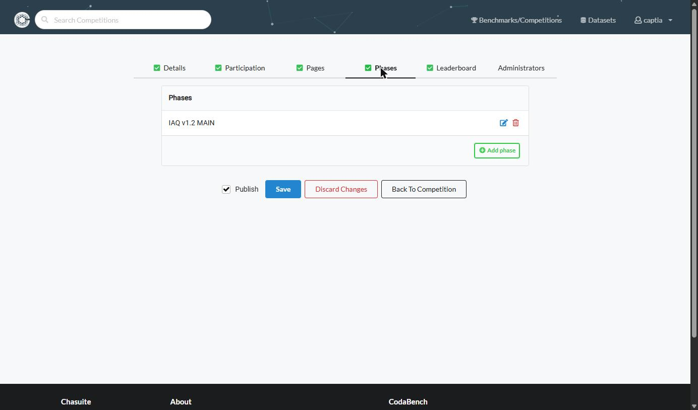
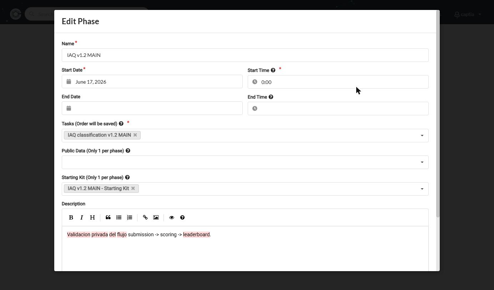
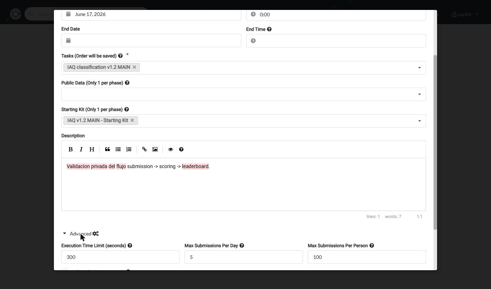

# Phases

**Objetivo:** definir las etapas temporales de la competición, con sus fechas y sus límites de submission, y enganchar a cada una la Task que la evalúa.

## Crear una fase

Volver al editor de la competición, pestaña **Phases**. La pestaña no es el formulario: es la **lista** de fases, y cada una se edita con su lápiz.

*Una competición de una sola fase es perfectamente válida. El botón **Add phase** añade las siguientes, y el orden en que aparecen aquí es el orden en que se suceden.*

1. Crear una fase (p. ej. `Development`) con:

| Campo | Qué pone |
|---|---|
| **Name**, **Description** | Cómo se llama la fase y qué se hace en ella. |
| **Start Date** / **Start Time** | Fecha y hora de apertura, en **dos campos separados**. La hora se introduce en **UTC+0**, no en la zona horaria del navegador; la ayuda del campo lo advierte. |
| **End Date** / **End Time** | Igual, para el cierre. Se pueden dejar vacíos (ver más abajo). |
| **Tasks** | La(s) Task(s) creada(s) en [Tasks](../recursos/tasks.md). El orden se guarda, y el desplegable muestra la descripción de cada una debajo del nombre — por eso vale la pena describirlas al crearlas. |
| **Public Data**, **Starting Kit** | Se asignan **por fase**, y solo cabe **uno de cada** en cada una: el propio rótulo lo advierte con «Only 1 per phase». |
| **Execution Time Limit (seconds)** | Tiempo máximo que pueden tardar ingestion y scoring por submission. **Si se deja vacío son 600 s**, y la cola por defecto impone un máximo propio. |
| **Max Submissions Per Day** | Límite diario por participante, de medianoche a medianoche UTC. |
| **Max Submissions Per Person** | Tope total por participante en esta fase. |

*`End Date` y `End Time` vacíos: es una fase sin cierre. Fíjate en «Only 1 per phase» de `Public Data` y `Starting Kit` — por fase solo cabe uno de cada, aunque haya varios subidos como recursos.*

:::tip[Los límites están plegados]
`Execution Time Limit`, los dos máximos de submissions y las casillas de ocultación **no se ven al abrir el formulario**: están dentro de **Advanced**, al final, junto al icono de engranajes. Es el sitio donde más se tarda en encontrar algo la primera vez.
:::

*Los valores de la captura son los de una competición interna de validación: 300 segundos por submission, 5 al día y 100 por participante.*

2. Repetir para cada fase adicional (p. ej. `Final`), reutilizando la misma Task si el scoring program no cambia, o creando una Task nueva si cambia el dataset oculto.

## Ocultar resultados en la fase final

La fase Development normalmente da feedback inmediato al participante; la fase Final suele ocultar resultados hasta el cierre para evitar el sobreajuste al leaderboard público. Eso no se consigue con el leaderboard, sino con tres casillas de la propia fase:

| Casilla | Qué oculta al participante |
|---|---|
| **Hide Submission Output** | Toda la salida de la submission. |
| **Hide Prediction Output** | La descarga del resultado del paso de predicción. |
| **Hide Score Output** | La descarga del resultado del paso de scoring. |

Hay además una casilla **Auto migrate to this phase**: al arrancar la fase, vuelve a enviar automáticamente todas las submissions que estaban en el leaderboard de la anterior. Es la forma de evaluar contra el dataset final lo que los participantes ya habían entregado, sin pedirles que suban nada otra vez.

## Fases sin fecha de cierre

:::note[End vacío]
Si **End** se deja vacío, la fase queda abierta indefinidamente (la cabecera pública muestra "Current Phase Ends: Never") — es válido para competiciones internas de validación sin fecha de cierre fija.
:::

**Siguiente paso:** [Leaderboards](./leaderboards.md) — la tabla donde se publican las métricas que devuelve el scoring program.
