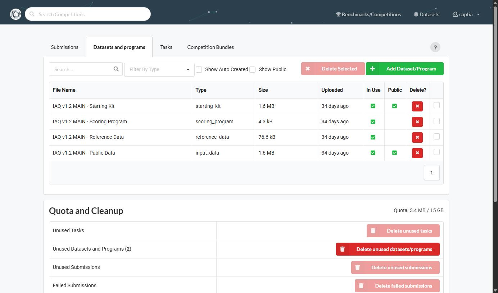

# Datasets y Programs

**Objetivo:** subir a Codabench los datos y el código que después consumirá la Task, una sola vez y de forma reutilizable.

Antes de crear una Task hacen falta los recursos que va a usar. Ir a **Resources → Datasets and programs** —«Resources» está en el menú de la cuenta, arriba a la derecha— (accesible también desde el botón **Manage Tasks/Datasets** dentro de la pestaña [Phases](../evaluacion/phases.md)).

Los tipos se ven mejor con el [ejemplo](../empezar/ejemplo.md) delante: los datos que descarga el participante, las etiquetas reales que nunca salen de aquí, y el código que compara las dos cosas.

:::warning[`input_data` y `public_data` no son lo mismo, y el nombre engaña]
Son dos tipos distintos y se eligen en sitios distintos:

- **`input_data`** es lo que consume la **Task**: los ficheros que el scoring program encontrará bajo `/app/input_data`.
- **`public_data`** es lo que se adjunta a una **fase** para que el participante lo descargue, en el campo `Public Data (Only 1 per phase)` del formulario de [Phases](../evaluacion/phases.md).

Un recurso llamado «Public Data» puede estar subido como `input_data` —es lo que ocurre cuando los ficheros que ve el participante son los mismos que consume la Task— y entonces el campo `Public Data` de la fase se queda vacío, que es correcto. Lo que no se puede es dar por hecho que el nombre del recurso indica su tipo: el tipo está en la columna **Type**.
:::

*La columna **Public** es la que hay que mirar dos veces: el starting kit y los datos públicos la tienen marcada, y **reference data y scoring program no**. Así es como tiene que quedar — si el ground truth aparece marcado como público, la competición está rota aunque todo lo demás funcione.*

*La columna **In Use** indica si algún Task lo referencia; los que no lo están se pueden borrar desde **Quota and Cleanup**, al final de la misma pantalla, que también muestra cuánto espacio queda de la cuota.*

## Subir los recursos

1. Click **Add Dataset/Program**.
2. Rellenar nombre, subir el `.zip` correspondiente y seleccionar el tipo de recurso.
3. Repetir para cada uno:
   - `input_data`
   - `reference_data`
   - `ingestion_program` (si aplica)
   - `scoring_program`
   - `starting_kit` / `public_data` (opcionales)

Los recursos se pueden marcar como públicos o privados, y son reutilizables entre Tasks y entre competiciones propias.

**Siguiente paso:** [El scoring program](./scoring-program.md) — qué lleva dentro ese zip, dónde encuentra los ficheros y dónde deja las métricas.
