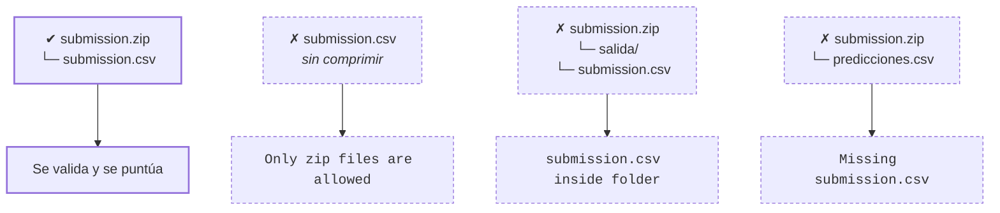

# Formato de submission

**Objetivo:** fijar el formato exacto que debe tener la entrega en una competición de predicciones directas, y que el scoring program lo rechace con un mensaje comprensible cuando no se cumple.

## Qué valida el scoring program

Cuando la Task no tiene ingestion program (el participante sube ya las predicciones, no código), el propio **scoring program** es responsable de validar la entrega antes de puntuar. Conviene documentar el formato exacto en la [página](../competicion/pages.md) `Evaluation`/`Submission` y hacer que el scoring program falle con un mensaje claro si no se cumple. Patrón típico:

- El participante sube un `.zip` con un único CSV **en la raíz** (no dentro de una carpeta), p. ej. `submission.zip → submission.csv`.
- El CSV tiene columnas fijas y conocidas de antemano — en el [ejemplo](../empezar/ejemplo.md), `id,prediccion_iaq_class`.
- El scoring program valida, antes de calcular métricas:

### La entrega correcta, y las tres que llegan mal

El error más frecuente no es el modelo: es el envoltorio. Estas son las cuatro formas en que llega un zip, y solo una pasa.

Merece la pena enseñar esta distinción en la página `Submission` de la competición: se ahorra la mitad de los mensajes en el foro.

| Error típico | Causa |
|---|---|
| `Only zip files are allowed` | Se subió el CSV suelto en vez de un `.zip`. |
| `Missing submission.csv` | El zip no contiene el fichero con el nombre exacto esperado. |
| `submission.csv inside folder` | El CSV está dentro de una subcarpeta en vez de en la raíz del zip. |
| `Invalid columns` | Las columnas no coinciden exactamente (nombre u orden) con lo esperado. |
| `IDs mismatch` | Faltan o sobran IDs respecto a `test.csv`/`reference_data`. |
| `Duplicate IDs` | Hay una fila repetida para el mismo ID. |
| `Prediction out of range` | El valor predicho no pertenece al conjunto de clases/valores válidos. |

## Sample submission

Publicar una **sample submission** de referencia (con un resultado esperado conocido, p. ej. "si subes la sample oficial deberías obtener `metric = X`") ayuda a que los participantes detecten pronto si algo en su entorno (fase, dataset, versión) no está bien apuntado, antes de perder tiempo con su propio modelo.

**Siguiente paso:** [Probar la competición](./probar.md) — comprobar con una submission real que la cadena entera funciona.
