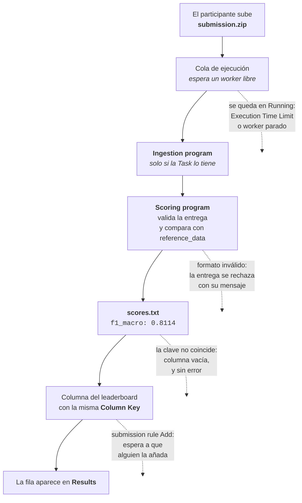

# Submissions

**Objetivo:** fijar qué entrega exactamente el participante y comprobar con una submission real que la cadena completa funciona antes de abrir la competición.

Las dos páginas de esta sección cierran el montaje: una define el contrato de entrega y en la otra lo recorre uno mismo, en el papel del participante.

1. [**Formato de submission**](./formato.md) — qué sube el participante cuando la Task no tiene ingestion program, y qué debe validar el scoring program antes de puntuar nada.
2. [**Probar la competición**](./probar.md) — subir una submission de prueba, seguir sus logs y verificar que el valor llega al leaderboard.

## Qué le pasa a una submission

De arriba abajo, con el punto en el que se rompe cada cosa señalado a la derecha:

Las cuatro ramas de puntos son, por orden de frecuencia, los cuatro motivos por los que un organizador cree que su competición está mal montada. Ninguno de los cuatro produce un error visible en la pantalla de la competición: hay que ir a buscarlos. El [troubleshooting](../referencia/troubleshooting.md) los recoge con su síntoma exacto.

Probar forma parte del montaje, no es un extra: hasta que una submission recorre ingestion, scoring y leaderboard, no hay ninguna evidencia de que la [Task](../recursos/tasks.md) y el [leaderboard](../evaluacion/leaderboards.md) estén apuntando a lo que se cree.
