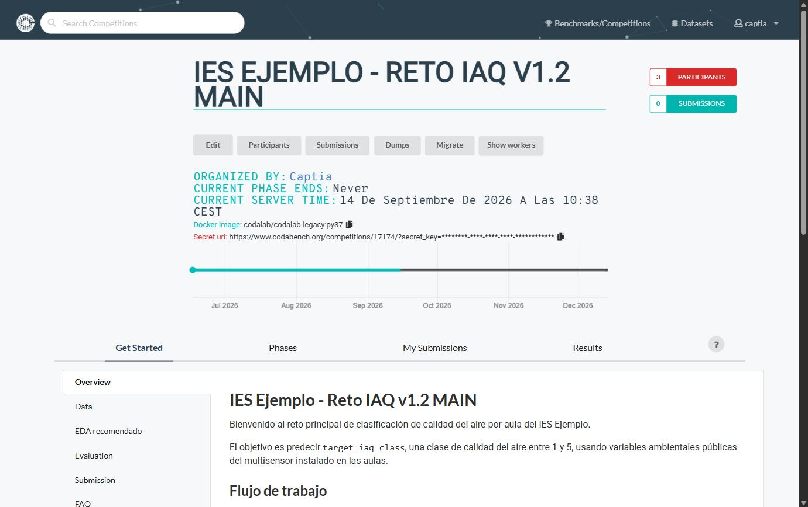

# Probar la competición

**Objetivo:** comprobar de extremo a extremo, con una submission real, que la cadena ingestion → scoring → leaderboard funciona antes de abrir la competición a los participantes.

## Recorrido de una submission de prueba

1. Publicar (o dejar en modo no listado) la competición y entrar a su página pública.

*Esta cabecera solo la ve quien administra la competición. **Participants** es donde se aprueban los registros pendientes —no está en Resources—, y **Submissions** lleva a todas las entregas, no solo a las propias.*

*Tres cosas de esta pantalla conviene mirar antes de probar nada: el contador de **PARTICIPANTS**, el **Docker image** con el que se ejecutará el scoring, y `CURRENT PHASE ENDS`, que dice `Never` cuando la fase no tiene fecha de cierre.*

:::danger[La «Secret url» es una credencial]
Esa línea de la cabecera lleva un `secret_key` que da acceso a la competición sin estar registrado. Sirve para repartir el enlace antes de publicarla; **no se pega en un chat público, ni en una incidencia, ni en una captura de pantalla**.
:::
2. Pestaña **My Submissions**: subir una submission de prueba (`.zip`) — dummy o real.
3. Seguir los logs en tiempo real mientras se procesa. Se agrupan en **pestañas** dentro del detalle de la submission —una por cada salida que exista: ingestion y scoring, con su stdout y su stderr—, y las que no tienen nada lo dicen en vez de aparecer vacías. Si la instancia es anterior a **Codabench v1.26**, en su lugar hay un bloque fijo de cuatro salidas por dos.
4. Verificar:
   - que el ingestion program (si existe) corre sin errores,
   - que el scoring program genera `scores.txt` con las claves esperadas,
   - que el leaderboard muestra el valor correctamente. La puntuación que se ve en el panel de la submission es la de la **Primary Column**, con los decimales fijados en **Column Precision** para esa columna.
5. Si la submission se procesa pero no aparece en el leaderboard, casi siempre **no es un fallo**: depende de la [submission rule](../evaluacion/submission-rule.md). Con `Add`, `Add And Delete` o `Add And Delete Multiple` —y `Add` es el valor por defecto— la submission espera a que alguien la añada. Abrir **Submissions** desde la cabecera de la competición —el botón lista las entregas de todos los participantes, no solo las propias—, localizar la submission procesada y usar la acción de añadirla al leaderboard. Con las tres reglas `Force` esto no hace falta: entra sola.

**Si algo no cuadra:** [troubleshooting](../referencia/troubleshooting.md) — el síntoma y su causa probable, antes de dar por mal montada la competición.
